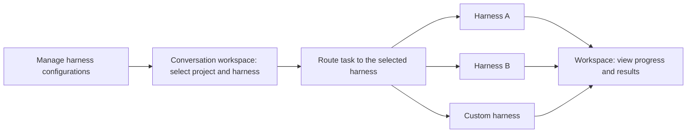

# YAgent

### The best way to put MetaHarness into practice

[中文](README.md) · [English](README.en.md)

**One workspace. Multiple harnesses. Choose how each conversation gets work done.**

YAgent is an open-source desktop AI agent workspace maintained by ViaTumLab. Our goal is to bring harness configuration, selection, and task entry into one place: manage your own harnesses, select an execution route in the conversation workspace, and follow the work through to review.

> **Project status:** A desktop agent workspace is available today. Harness management and conversation routing are the next core development priorities. The related experience described below is planned.

## Why MetaHarness

Completing a task takes a model and a harness that organizes context, tools, execution, and feedback around it. Coding, research, and automation can each benefit from their own configuration and workflow.

YAgent's MetaHarness direction is to **manage and select harnesses in a shared workspace, routing tasks to the execution environment you choose.** Model selection determines which model service to use; harness selection determines how the task is organized and executed.

## The core experience: manage harnesses, choose a route

### 1. Configure your own harnesses

The planned management interface will maintain multiple harness configurations, including names, connection methods, connection or startup parameters, and descriptions of supported capabilities. Add, edit, enable, or disable configurations and check connectivity to keep your preferred environments ready to select.

### 2. Choose a harness in the conversation workspace

When starting a conversation, select a project and a harness, then send your task. Different conversations in the same project can use different harnesses, allowing coding, research, and other work to use suitable execution workflows.

Routing starts with an explicit user choice: **see the selected harness before sending, and know where the task is running afterward.**

### 3. Follow progress and results in one place

The goal is to bring execution progress, outputs, and artifacts from different harnesses into a shared workspace for follow-up conversations and review. File changes, tool calls, and approvals will be integrated progressively according to each harness's interfaces and adapter support.



*This diagram illustrates the planned interaction flow. Available harness integrations will depend on released adapters.*

## How you could use it

| Scenario | Planned workflow |
| --- | --- |
| Develop a feature | Select a coding harness in a project conversation, send the requirements, and review code changes |
| Research the same project | Start another conversation, choose a research harness, and collect sources and findings |
| Use your own execution environment | Add a custom harness in management, then select it in the conversation workspace |
| Keep configurations for different tasks | Maintain multiple harness configurations and choose the appropriate one when starting a task |

## Current workspace capabilities

YAgent's existing desktop workspace provides the interface foundation for harness management and routing.


*Current workspace screenshot; the harness management and routing interfaces are planned.*

- **Projects and code:** Read files, find symbols, analyze project structure, edit code, and run tests.
- **Task collaboration:** Coordinate multiple agents and inspect progress and deliverables.
- **Browser and tools:** Work with the built-in browser, desktop tools, plugins, skills, and MCP services.
- **Model connections:** Configure different model services and select models for each task.
- **Change review:** Inspect file diffs and organize development with Git and workspaces.

## Roadmap

- [ ] **Harness management:** Configuration list, creation and editing, enable/disable controls, and connectivity checks.
- [ ] **Workspace selection:** Select a harness when starting a conversation and clearly display the chosen route.
- [ ] **Execution integration:** Send tasks to the selected harness and receive execution status and output.
- [ ] **Adapter expansion:** Refine integration conventions and progressively support more harnesses and custom implementations.

## Local development

The current source primarily targets **Windows x64**. Install Git, Node.js 22, and npm:

```powershell
git clone https://github.com/ViaTumLab/YAgent.git
cd YAgent
npm ci
npm run dev
```

| Command | Purpose |
| --- | --- |
| `npm start` | Start the application |
| `npm test` | Run unit tests |
| `npm run build` | Build the Windows installer |
| `npm run build:release` | Build installer and portable packages |

Some features require additional runtimes. See the `build:desktop-bridge`, `build:cua-driver`, and `build:playwright` scripts in `package.json`. Build outputs are written to `dist/`.

This repository has not published installers yet. Future versions will be available on the [Releases](https://github.com/ViaTumLab/YAgent/releases) page.

## Contributing

Pull requests improving harness integrations, workspace routing, configuration management, model integrations, and usability are welcome. Share the harnesses you would like to connect and the workflows you need. Describe the use case, scope, and validation of your changes.

## Acknowledgments

Thank you to **[Yan-Agent](https://github.com/666-gy/Yan-Agent)**, **[Yanxi / 666-gy](https://github.com/666-gy)**, and all contributors for their open-source work and contributions. Thank you to OpenCode, Electron, and other open-source projects for their foundational capabilities.

## License

This project uses the [MIT License](LICENSE). Applicable copyright notices and license texts are retained. Third-party components, skills, and assets remain subject to their respective licenses; see [third-party notices](lib/THIRD_PARTY_NOTICES.md) and [skill notices](lib/skills/THIRD_PARTY_NOTICES.md).
