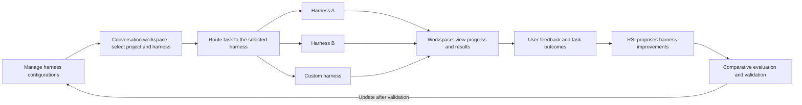

<p align="center">
  
</p>

<h1 align="center">OpenMetaHarness</h1>

<h3 align="center">Build, manage, and evolve your agent harnesses.</h3>

<p align="center">
  <strong>Build and maintain harnesses together with AI.<br />Make your agent workflows editable, runnable, and measurable.</strong>
</p>

<p align="center">
  <a href="README.md">中文</a> · <a href="README.en.md">English</a>
</p>

<p align="center">
  <a href="#roadmap"></a>
  <a href="#download-and-install"></a>
  <a href="#local-development"></a>
  <a href="LICENSE"></a>
</p>

<p align="center">
  <a href="#download-and-install">Download</a> ·
  <a href="#the-core-experience">Core experience</a> ·
  <a href="#local-development">Get started</a> ·
  <a href="#roadmap">Roadmap</a> ·
  <a href="https://github.com/ViaTumLab/OpenMetaHarness/releases">Releases</a> ·
  <a href="#acknowledgments">Acknowledgments</a>
</p>

<br />

---

## Download and install

OpenMetaHarness evolves from YAgent and is maintained by ViaTumLab. Its new client is named **ViaHarness Studio**. The current code and released installers remain the Yan Agent / YAgent baseline; the installed application is still named **Yan Agent**. We will preserve the execution kernels and focus on visual harness configuration, shared maintenance by users and AI, routing, and version management. OpenCode / OpenHarness adapters and later RSI improvements are planned. See the [product and development plan (Chinese)](docs/plans/openmetaharness-product-and-development-plan.md).

**[Download the macOS Apple Silicon preview](https://github.com/ViaTumLab/OpenMetaHarness/releases/tag/macos-v1.7.0-preview.2)** · [All releases](https://github.com/ViaTumLab/OpenMetaHarness/releases) · [Build status](https://github.com/ViaTumLab/OpenMetaHarness/actions/workflows/macos-build.yml)

| Platform | Status | How to get it |
| --- | --- | --- |
| macOS · Apple Silicon (M series / arm64) | Preview; ad hoc signed, not notarized | Download the release's `.dmg` and `SHA256SUMS` |
| macOS · Intel (x64) | Not yet supported | Requires a separately verified kernel patch |
| Windows · x64 | Source builds retained | Run `npm run build` on Windows; this Mac preview does not include a Windows installer |

### Install on a Mac

1. Download the `.dmg` release asset, open it, and drag **Yan Agent** into **Applications**.
2. Launch it from Applications. This preview is not Apple-notarized, so macOS may block the first launch. After verifying the repository source and checksum, follow [Apple's instructions](https://support.apple.com/102445) to choose **Open Anyway** under **System Settings → Privacy & Security**. Do not disable Gatekeeper globally.
3. Add a model connection in settings, configure its API URL and API key, and select an available model. Provider accounts and usage charges are separate from the desktop client.
4. Select a project workspace, create a conversation, and send a task. Installing the DMG does not require this repository's npm development dependencies.

To verify a download, save the `.dmg` and `SHA256SUMS` in the same directory and run:

```sh
shasum -a 256 -c SHA256SUMS
```

### macOS preview scope

- Packaged startup, the bundled OpenCode / CodeGraph / OfficeCLI runtimes, and 18 model-provider adapters are verified. Adapter tests use local mock services, not live user accounts.
- Windows desktop control, application snapshots, and speech recognition are unavailable on macOS.
- Chromium is downloaded when installing the Playwright plugin; initial installation needs network access.
- Updates require manually downloading the Mac installer. Intel support, Developer ID signing, and Apple notarization remain pending.
- Harness management, conversation routing, and RSI improvement are roadmap items, not completed preview features.

Formal notarization requires Apple Developer Program membership, normally **USD 99 per year**, with regional pricing shown during [Apple enrollment](https://developer.apple.com/programs/enroll/). Notarization is included in membership services rather than billed per installer. Installing or building the current preview does not require paid membership. See the [macOS release and notarization guide (Chinese)](docs/macos-release.md) for prerequisites and the work still needed in this project.

## Different harnesses. A shared place to work.

OpenMetaHarness is an open-source platform project maintained by ViaTumLab, with harnesses at its core and a planned visual workbench client named **ViaHarness Studio**. Our goal is to let users visually maintain agent workflows and let models propose improvements through the same configuration and change mechanisms: create your harnesses, choose a route for each task, then review execution, results, and version differences.

We also aim to continuously improve harnesses through user feedback and RSI (Recursive Self-Improvement), with a clear development goal: **make OpenMetaHarness more effective the more you use it.**

<table>
  <tr>
    <td width="33%" valign="top">
      <h3>01 · Manage</h3>
      <p>Visually configure instructions, models, tools, context, and policies, with harness versions, connections, and availability in one place.</p>
    </td>
    <td width="33%" valign="top">
      <h3>02 · Route</h3>
      <p>Select a harness for each conversation and send the task to the right execution environment.</p>
    </td>
    <td width="33%" valign="top">
      <h3>03 · Improve</h3>
      <p>Turn user feedback and task outcomes into evidence for RSI-driven harness improvements, helping future tasks perform better.</p>
    </td>
  </tr>
</table>

> [!NOTE]
> The Yan Agent / YAgent desktop workspace is available today. Visual harness management, shared maintenance by users and AI, conversation routing, and feedback-driven RSI improvements are planned. See the [development plan (Chinese)](docs/plans/openmetaharness-product-and-development-plan.md) for scope and acceptance criteria.

## Why harnesses are the core

Completing a task takes a model and a harness that organizes context, tools, execution, and feedback around it. Coding, research, and automation can each benefit from their own configuration and workflow.

OpenMetaHarness treats each harness as a core object with its own identity, configuration, and versions: **users and AI build and maintain harnesses in a shared workspace, route tasks to a selected runtime, and evaluate each proposed improvement.** Model selection determines which model service to use; a harness defines how work is organized and executed. Planned adapters will connect execution backends such as OpenCode and OpenHarness.

## The core experience

### 1. Configure your own harnesses

The planned visual editor will maintain instructions, models, tools, skills, context, permissions, and acceptance rules, with runtime connections and capabilities managed separately. Users can edit configurations directly; models can explain them and propose changes. Both use the same drafts, validation, diffs, evaluations, and publishing mechanisms, with version history and rollback support.

### 2. Choose a harness in the conversation workspace

When starting a conversation, select a project and a harness, then send your task. Different conversations in the same project can use different harnesses, allowing coding, research, and other work to use suitable execution workflows.

Routing starts with an explicit user choice: **see the selected harness before sending, and know where the task is running afterward.**

### 3. Follow progress and results in one place

The goal is to bring execution progress, outputs, and artifacts from different harnesses into a shared workspace for follow-up conversations and review. File changes, tool calls, and approvals will be integrated progressively according to each harness's interfaces and adapter support.

### 4. Make each piece of feedback a starting point for improvement

The planned improvement loop will combine user ratings, corrections, and task outcomes with RSI algorithms to repeatedly propose, validate, and iterate on harness improvements. Areas for optimization include context organization, prompts and rules, tool use, and execution workflows, depending on the configuration and integration capabilities each harness exposes.

**Run a task → Collect feedback → Generate improvements with RSI → Evaluate and validate → Update the harness → Run again.**

Each candidate improvement will be evaluated against the current version before adoption, with version history and rollback support. The goal is to turn real usage into measurable improvements, making OpenMetaHarness progressively better suited to your tasks and more effective over time.



*This diagram illustrates the planned interaction flow. Available harness integrations will depend on released adapters.*

## How you could use it

| Scenario | Planned workflow |
| --- | --- |
| Develop a feature | Select a coding harness in a project conversation, send the requirements, and review code changes |
| Research the same project | Start another conversation, choose a research harness, and collect sources and findings |
| Use your own execution environment | Add a custom harness in management, then select it in the conversation workspace |
| Keep configurations for different tasks | Maintain multiple harness configurations and choose the appropriate one when starting a task |
| Improve recurring tasks | Provide feedback and corrections, then use RSI to propose and validate harness improvements for future tasks |

## Current workspace capabilities

The following capabilities and screenshot belong to the existing Yan Agent / YAgent baseline, which provides client and infrastructure modules for migration. The new ViaHarness Studio management interface is still planned.

<p align="center">
  
</p>
<p align="center"><sub>Yan Agent / YAgent baseline screenshot · ViaHarness Studio visual workbench is planned</sub></p>

- **Projects and code:** Read files, find symbols, analyze project structure, edit code, and run tests.
- **Task collaboration:** Coordinate multiple agents and inspect progress and deliverables.
- **Browser and tools:** Work with the built-in browser, desktop tools, plugins, skills, and MCP services.
- **Model connections:** Configure different model services and select models for each task.
- **Change review:** Inspect file diffs and organize development with Git and workspaces.

## Roadmap

See the [OpenMetaHarness product and development plan (Chinese)](docs/plans/openmetaharness-product-and-development-plan.md) for the full design, code architecture, infrastructure gaps, phased tasks, and acceptance criteria.

- [ ] **Harness management:** Visual configuration, draft validation, version publishing and rollback, and separate runtime connection management.
- [ ] **Shared maintenance by users and AI:** Edit the same configuration objects, with change proposals, diffs, and evaluation results.
- [ ] **Workspace selection:** Select a harness when starting a conversation and clearly display the chosen route.
- [ ] **Execution integration:** Validate OpenCode / OpenHarness adapters while preserving execution kernels; integrate status, approvals, cancellation, and output.
- [ ] **Feedback loop:** Collect user ratings, corrections, and task outcomes as evidence for harness improvements.
- [ ] **Continuous improvement with RSI:** Generate candidate improvements, evaluate against the current version, and iterate with version tracking and rollback support.
- [ ] **Adapter expansion:** Refine integration conventions and progressively support more harnesses and custom implementations.

## Local development

Builds are supported for **Windows x64** and **macOS Apple Silicon (arm64)**. Install Git, Node.js 22, and npm:

```sh
git clone https://github.com/ViaTumLab/OpenMetaHarness.git
cd OpenMetaHarness
npm ci
npm run dev
```

| Command | Purpose |
| --- | --- |
| `npm start` | Start the application |
| `npm test` | Run unit tests |
| `npm run build` | Build the Windows installer |
| `npm run build:release` | Build installer and portable packages |
| `npm run build:mac` | Build an Apple Silicon DMG and verify resources, provider adapters, and startup |
| `npm run verify:mac` | Recheck an existing macOS build |

Some features require additional runtimes. See the `build:desktop-bridge`, `build:cua-driver`, and `build:playwright` scripts in `package.json`. Build outputs are written to `dist/`.

macOS requires arm64 Node.js. Building downloads dependencies and Chromium verification assets; see the [macOS release guide](docs/macos-release.md). GitHub Actions checks Mac builds and publishes a preview with checksums only after a `macos-v*` tag passes its build and tests.

## Contributing

Pull requests improving harness integrations, workspace routing, feedback mechanisms, RSI improvements and evaluation, configuration management, and usability are welcome. Share the harnesses you would like to connect and the workflows you need. Describe the use case, scope, and validation of your changes.

## Acknowledgments

Thank you to **[Yan-Agent](https://github.com/666-gy/Yan-Agent)**, **[Yanxi / 666-gy](https://github.com/666-gy)**, and all contributors for their open-source work and contributions. Thank you to OpenCode, Electron, and other open-source projects for their foundational capabilities.

## License

This project uses the [MIT License](LICENSE). Applicable copyright notices and license texts are retained. Third-party components, skills, and assets remain subject to their respective licenses; see [third-party notices](lib/THIRD_PARTY_NOTICES.md) and [skill notices](lib/skills/THIRD_PARTY_NOTICES.md).
