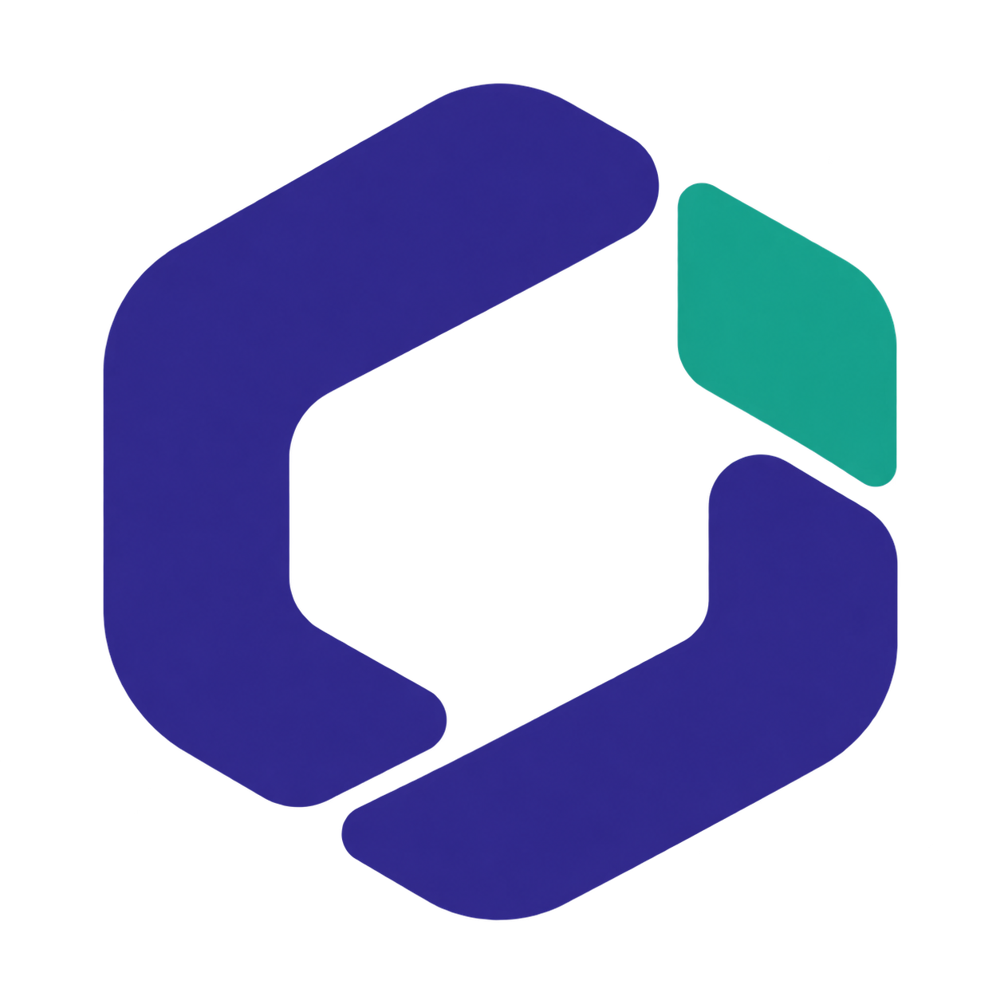
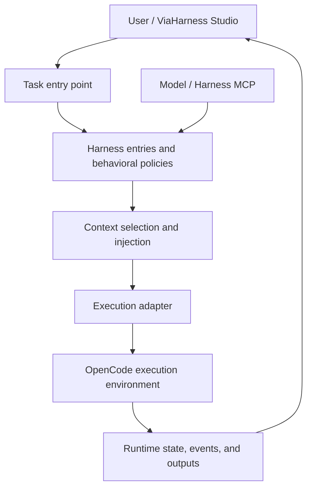

<p align="center">
  
</p>

<h1 align="center">OpenMetaHarness</h1>

<h3 align="center">The open core for agent harnesses.</h3>

<p align="center">
  <strong>Organize how agents work, with the harness at the center.<br />Manage policies, context, capabilities, and runtime state in one place.</strong>
</p>

<p align="center">
  <a href="README.md">中文</a> · <a href="README.en.md">English</a>
</p>

<p align="center">
  <a href="#core-capabilities"></a>
  <a href="#shared-management-by-users-and-models"></a>
  <a href="LICENSE"></a>
</p>

<p align="center">
  <a href="#core-capabilities">Core capabilities</a> ·
  <a href="#runtime-architecture">Architecture</a> ·
  <a href="#shared-management-by-users-and-models">Management interface</a> ·
  <a href="#run-from-source">Run from source</a> ·
  <a href="#viaharness-studio">Client</a>
</p>

---

**OpenMetaHarness is an open-source harness core built around agent execution.** It organizes behavioral instructions, memory, skills, subagent configurations, and task state so that the way an agent works can be inspected, maintained, and traced.

A harness determines which rules apply to a task, what context it receives, how reusable capabilities are organized, and how execution is recorded. OpenMetaHarness provides this control layer, connects to the execution environment through an OpenCode adapter, and uses **ViaHarness Studio** as its desktop interface.

## Core capabilities

### Harness asset management

Manage `prompt`, `memory`, `skill`, and `subagent` entries through a common storage and management layer for behavioral rules, persistent memory, skills, and subagent configurations.

- **Scope:** Global and workspace entries are stored separately, supporting shared and project-specific configurations.
- **Status:** Query entries by type, scope, and activation status.
- **Changes:** Keep revisions and snapshots, detect concurrent changes, and roll back entries.
- **Provenance:** Associate changes with tasks, sessions, and evidence to keep a traceable maintenance record.

### Context selection and injection

Select harness entries according to task relevance and a content budget, then assemble behavioral policies and experience into execution context. Explicit user rules are handled separately from general experience, while workspace information accompanies each task.

Run records reference the entries actually injected, making it possible to inspect the context used for a task and where it came from.

### Task lifecycle

The core uses **Thread, Turn, Item, and Event** to represent conversations, individual executions, intermediate outputs, and events. Streaming text, tool calls, file changes, cancellation requests, and execution results share a common state and event record.

State snapshots and event logs preserve runtime information, supporting record recovery after restart and reconciliation of unfinished tasks.

### Execution adapters and model connections

The execution adapter interface handles task startup, cancellation, health checks, and result normalization. The existing OpenCode adapter connects to the execution environment.

The model connection layer selects provider request protocols using explicit configuration and model information, handling differences between model service interfaces. Harness state, task state, and model connections each have a distinct responsibility.

## Runtime architecture



| Layer | Responsibility | Source |
| --- | --- | --- |
| Harness state | Entries, scopes, revisions, snapshots, and rollback | [State store](lib/continual-harness.js) |
| Policies and context | User rules, entry selection, and task context assembly | [Policy handling](lib/main/harness-policy.js) · [Task orchestration](lib/run-orchestrator.js) |
| Management interface | Model queries, change requests, deletion, and rollback requests | [Harness MCP](lib/yan-harness-mcp.js) |
| Runtime core | Thread / Turn / Item, lifecycle, and event persistence | [Core modules](lib/yan-core/) |
| Execution integration | Startup, cancellation, health checks, and backend connections | [Adapter interface](lib/yan-core/adapter.js) |
| Model protocols | Provider request protocol selection | [Protocol routing](lib/provider-adapter-routing.js) |

## Shared management by users and models

Users maintain behavioral rules through explicit, lasting instructions. Models use Harness MCP to read existing entries and submit change requests with task context.

| Operation | MCP tools |
| --- | --- |
| List entries and read their contents | `list_entries`, `get_entry` |
| Submit changes and check processing status | `schedule_refinement`, `get_refinement_status` |
| Delete entries or request rollback under user instructions | `delete_entry`, `schedule_rollback` |

The harness storage and policy layers process changes and associate them with scopes, revisions, and provenance. User instructions, model operations, and run records can therefore work with the same harness state.

## Run from source

Install Git, Node.js 22, and npm:

```sh
git clone https://github.com/ViaTumLab/OpenMetaHarness.git
cd OpenMetaHarness
npm ci
npm run dev
```

The core modules are integrated into this repository. These commands start the desktop development environment.

| Command | Purpose |
| --- | --- |
| `npm run dev` | Start the development environment |
| `npm test` | Run unit tests |
| `npm run build` | Build the Windows x64 client |
| `npm run build:mac` | Build and verify the macOS Apple Silicon client |

See the [technical reference](docs/technical-reference.md) for module and project details, and [package.json](package.json) for build scripts.

## ViaHarness Studio

**ViaHarness Studio** is the desktop client for OpenMetaHarness, providing project management, task interaction, model connections, and result review.

Client downloads are available on the [Releases page](https://github.com/ViaTumLab/OpenMetaHarness/releases). Consult the relevant release notes for installation requirements. For macOS source builds, see the [build guide](docs/macos-release.md).

## Contributing

Contributions to harness state management, context organization, execution adapters, MCP interfaces, and runtime reliability are welcome. Include the use case, scope, and validation results in your pull request.

## License

This project uses the [MIT License](LICENSE). See the [third-party notices](lib/THIRD_PARTY_NOTICES.md), [skill notices](lib/skills/THIRD_PARTY_NOTICES.md), and licenses distributed with individual components for copyright and third-party licensing information.
