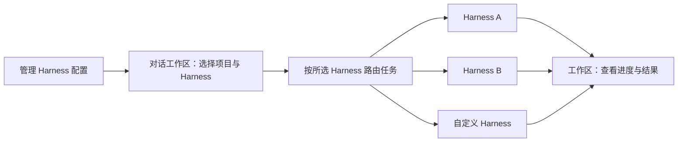

<p align="center">
  
</p>

<h1 align="center">YAgent</h1>

<h3 align="center">MetaHarness的最佳实践方式</h3>

<p align="center">
  <strong>一个工作区，管理多种 Harness。<br />让每次对话，都有合适的执行方式。</strong>
</p>

<p align="center">
  <a href="README.md">中文</a> · <a href="README.en.md">English</a>
</p>

<p align="center">
  <a href="#建设路线"></a>
  <a href="#本地开发"></a>
  <a href="LICENSE"></a>
</p>

<p align="center">
  <a href="#核心体验">核心体验</a> ·
  <a href="#本地开发">开始开发</a> ·
  <a href="#建设路线">建设路线</a> ·
  <a href="https://github.com/ViaTumLab/YAgent/releases">版本发布</a> ·
  <a href="#鸣谢">鸣谢</a>
</p>

<br />

---

## 让不同的 Harness，在同一个工作区里各展所长

YAgent 是由 ViaTumLab 维护的开源桌面 AI 智能体工作区。我们希望把不同 Harness 的配置、选择与任务入口放到一起：你管理自己的 Harness，在对话工作区选择本次任务的执行路由，再查看过程、审阅结果。

<table>
  <tr>
    <td width="33%" valign="top">
      <h3>01 · 统一管理</h3>
      <p>配置自己的 Harness，集中管理连接方式、启动参数与可用状态。</p>
    </td>
    <td width="33%" valign="top">
      <h3>02 · 对话路由</h3>
      <p>在工作区选择本次对话的 Harness，让任务进入合适的执行环境。</p>
    </td>
    <td width="33%" valign="top">
      <h3>03 · 结果回到工作区</h3>
      <p>在同一处跟进执行进度、查看产物，并继续对话与审阅。</p>
    </td>
  </tr>
</table>

> [!NOTE]
> 当前已有桌面智能体工作区。上方介绍的 Harness 管理与对话路由为下一阶段的核心规划，具体进展见[建设路线](#建设路线)。

## 为什么是 MetaHarness

完成一个任务，需要模型，也需要围绕模型组织上下文、工具、执行流程与反馈的 Harness。不同任务适合不同的执行方式：编码、研究、自动化操作，可以有各自的配置与工作流程。

YAgent 将 MetaHarness 作为产品方向：**在统一工作区中管理和选择 Harness，把任务交给你指定的执行环境。** 模型选择与 Harness 选择各有作用，前者决定使用哪个模型服务，后者决定任务如何组织和执行。

## 核心体验

### 1. 配置你自己的 Harness

规划中的 Harness 管理入口将支持维护多个 Harness 配置，包括名称、接入方式、连接或启动参数，以及该 Harness 支持的能力说明。你可以添加、编辑、启用或停用配置，并检查连接状态，让常用的执行环境随时可选。

### 2. 在对话工作区选择执行方式

发起对话时，在工作区选择项目和 Harness，再发送任务。同一个项目可以为不同对话选择不同 Harness，让编码、调研与其他工作使用各自合适的执行方式。

路由以用户的明确选择为起点：**发送前看得见当前选择，发送后知道任务交给了谁。**

### 3. 在同一处跟进任务与结果

目标是让不同 Harness 的执行进度、输出与产物回到同一个工作区，方便继续对话和审阅交付。文件变更、工具调用与审批等能力，将根据各 Harness 的接口和适配情况逐步接入。



*上图展示规划中的交互流程，具体可接入的 Harness 以实际发布的适配器为准。*

## 你可以怎样使用

| 场景 | 规划中的使用方式 |
| --- | --- |
| 开发一个新功能 | 在项目对话中选择用于编码的 Harness，提交需求并审阅代码变更 |
| 围绕同一个项目做调研 | 新建对话，选择用于研究的 Harness，整理资料与结论 |
| 使用自己的执行环境 | 在管理入口添加自定义 Harness，再从对话工作区选择它 |
| 为不同任务保留不同配置 | 管理多套 Harness 配置，发起任务时选择对应的执行方式 |

## 现有工作区能力

YAgent 已有的桌面工作区，为 MetaHarness 的管理与路由提供交互基础。

<p align="center">
  
</p>
<p align="center"><sub>当前桌面工作区 · Harness 管理与路由界面规划中</sub></p>

- **项目与代码：** 阅读文件、检索符号、分析项目结构、修改代码与运行测试。
- **任务协作：** 组织多个智能体处理任务，查看执行进度与交付结果。
- **浏览器与工具：** 操作内置浏览器，连接桌面工具、插件、技能与 MCP 服务。
- **模型接入：** 配置不同模型服务，并为任务选择合适的模型。
- **变更审阅：** 查看文件差异，通过 Git 与工作区管理开发过程。

## 建设路线

- [ ] **Harness 管理：** 配置列表、添加与编辑、启停及连接检查。
- [ ] **工作区选择：** 在发起对话时选择 Harness，清楚展示当前路由。
- [ ] **执行接入：** 将任务发送给所选 Harness，并接回执行状态与输出。
- [ ] **适配扩展：** 完善接入约定，逐步支持更多 Harness 与自定义实现。

## 本地开发

当前源码主要面向 **Windows x64**。准备 Git、Node.js 22 和 npm：

```powershell
git clone https://github.com/ViaTumLab/YAgent.git
cd YAgent
npm ci
npm run dev
```

| 命令 | 用途 |
| --- | --- |
| `npm start` | 启动应用 |
| `npm test` | 运行单元测试 |
| `npm run build` | 构建 Windows 安装包 |
| `npm run build:release` | 构建安装包与便携版 |

部分功能需要准备额外运行时，可参考 `package.json` 中的 `build:desktop-bridge`、`build:cua-driver` 与 `build:playwright` 命令。构建产物位于 `dist/`。

本仓库尚未发布安装包，后续版本以 [Releases](https://github.com/ViaTumLab/YAgent/releases) 为准。

## 参与项目

欢迎通过 Pull Request 参与 Harness 接入、工作区路由、配置管理、模型适配和体验优化。也欢迎分享你希望接入的 Harness 与实际使用场景。提交改动时请说明使用场景、变更范围与验证结果。

## 鸣谢

感谢 **[Yan-Agent](https://github.com/666-gy/Yan-Agent)**、**[Yanxi / 666-gy](https://github.com/666-gy)** 及所有贡献者的开源工作与贡献。感谢 OpenCode、Electron 及其他开源项目提供的基础能力。

## 许可证

本项目采用 [MIT License](LICENSE)。相关版权声明与许可文本予以保留。第三方组件、技能和素材遵循各自许可证，详见 [第三方声明](lib/THIRD_PARTY_NOTICES.md) 和 [技能声明](lib/skills/THIRD_PARTY_NOTICES.md)。
