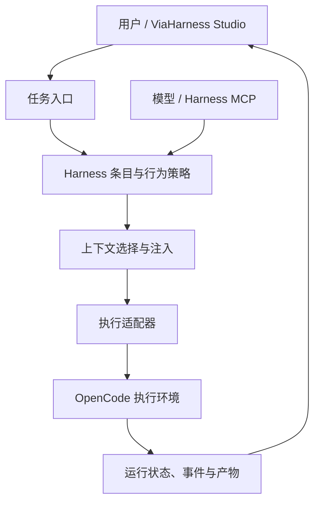

<p align="center">
  
</p>

<h1 align="center">OpenMetaHarness</h1>

<h3 align="center">The open core for agent harnesses.</h3>

<p align="center">
  <strong>以 Harness 为核心，组织 Agent 的工作方式。<br />统一管理策略、上下文、能力与运行状态。</strong>
</p>

<p align="center">
  <a href="README.md">中文</a> · <a href="README.en.md">English</a>
</p>

<p align="center">
  <a href="#内核能力"></a>
  <a href="#用户与模型共同管理"></a>
  <a href="LICENSE"></a>
</p>

<p align="center">
  <a href="#内核能力">内核能力</a> ·
  <a href="#运行结构">运行结构</a> ·
  <a href="#用户与模型共同管理">管理接口</a> ·
  <a href="#源码运行">源码运行</a> ·
  <a href="#viaharness-studio">客户端</a>
</p>

---

**OpenMetaHarness 是围绕 Agent 执行过程构建的开源 Harness 内核。** 它将行为指令、记忆、技能、子智能体配置与任务状态组织起来，让 Agent 的工作方式可以被读取、维护和追踪。

Harness 决定一次任务使用哪些规则、带入什么上下文、如何组织可复用能力，以及执行过程如何记录。OpenMetaHarness 聚焦这层控制能力，通过 OpenCode 适配器连接执行环境，由 **ViaHarness Studio** 提供桌面交互入口。

## 内核能力

### Harness 资产管理

用结构化条目管理 `prompt`、`memory`、`skill` 和 `subagent`，将行为规则、持久记忆、技能与子智能体配置纳入同一套存储与管理机制。

- **作用域：** 全局条目与工作区条目分别保存，支持通用配置与项目配置。
- **状态：** 按类型、作用域和激活状态查询条目。
- **变更：** 保存修订记录和快照，检测并发冲突，并支持回滚。
- **来源：** 将变更与任务、会话和证据关联，保留可追踪的维护记录。

### 上下文选择与注入

根据当前任务的相关性和内容预算选择 Harness 条目，将行为策略与经验内容组织为执行上下文。明确的用户规则与一般经验分别处理，工作区信息随任务传入。

运行记录关联实际注入的条目，便于查看一次任务使用了哪些上下文及其来源。

### 任务生命周期

内核以 **Thread、Turn、Item、Event** 表达会话、单次执行、过程产物与事件。流式文本、工具调用、文件变化、取消请求与执行结果进入统一的状态和事件记录。

状态快照与事件日志共同保存运行信息，支持重启后的记录恢复和未完成任务状态核对。

### 执行适配与模型连接

执行适配接口集中处理任务启动、取消、健康检查与结果规范化，现有 OpenCode 适配器连接实际执行环境。

模型连接侧依据显式配置和模型信息选择供应商请求协议，处理模型服务之间的接口差异。Harness 状态、任务状态与模型连接各有清晰的职责。

## 运行结构



| 层 | 职责 | 源码入口 |
| --- | --- | --- |
| Harness 状态 | 条目、作用域、修订、快照与回滚 | [状态存储](lib/continual-harness.js) |
| 策略与上下文 | 用户规则、条目选择与任务上下文组装 | [策略处理](lib/main/harness-policy.js) · [任务编排](lib/run-orchestrator.js) |
| 管理接口 | 模型查询、变更请求、删除与回滚请求 | [Harness MCP](lib/yan-harness-mcp.js) |
| 运行内核 | Thread / Turn / Item、生命周期与事件持久化 | [核心模块](lib/yan-core/) |
| 执行接入 | 启动、取消、健康检查与执行后端衔接 | [适配接口](lib/yan-core/adapter.js) |
| 模型协议 | 供应商请求协议选择 | [协议路由](lib/provider-adapter-routing.js) |

## 用户与模型共同管理

用户可以通过明确的长期指令维护行为规则；模型通过 Harness MCP 读取已有条目，并提交带有任务上下文的变更请求。

| 操作 | MCP 工具 |
| --- | --- |
| 查询条目列表与内容 | `list_entries`、`get_entry` |
| 提交变更并查询处理状态 | `schedule_refinement`、`get_refinement_status` |
| 按用户指令删除条目或请求回滚 | `delete_entry`、`schedule_rollback` |

变更由 Harness 存储与策略层处理，关联作用域、修订和来源。用户指令、模型操作与运行记录因此可以围绕同一套 Harness 状态协作。

## 源码运行

准备 Git、Node.js 22 和 npm：

```sh
git clone https://github.com/ViaTumLab/OpenMetaHarness.git
cd OpenMetaHarness
npm ci
npm run dev
```

核心模块随本仓库源码集成，上述命令启动桌面开发环境。

| 命令 | 用途 |
| --- | --- |
| `npm run dev` | 启动开发环境 |
| `npm test` | 运行单元测试 |
| `npm run build` | 构建 Windows x64 客户端 |
| `npm run build:mac` | 构建并验证 macOS Apple 芯片客户端 |

模块与工程说明见[技术参考](docs/technical-reference.md)，构建脚本见 [package.json](package.json)。

## ViaHarness Studio

**ViaHarness Studio** 是 OpenMetaHarness 的桌面客户端入口，用于项目管理、任务交互、模型连接和结果审阅。

客户端下载见 [Releases](https://github.com/ViaTumLab/OpenMetaHarness/releases)，安装要求以对应版本说明为准。macOS 源码构建说明见[构建指南](docs/macos-release.md)。

## 参与贡献

欢迎参与 Harness 状态管理、上下文组织、执行适配、MCP 接口和运行可靠性相关工作。提交 Pull Request 时，请说明使用场景、变更范围和验证结果。

## 许可证

本项目采用 [MIT License](LICENSE)。版权与第三方许可信息见 [第三方声明](lib/THIRD_PARTY_NOTICES.md)、[技能声明](lib/skills/THIRD_PARTY_NOTICES.md)及各组件随附的许可文件。
