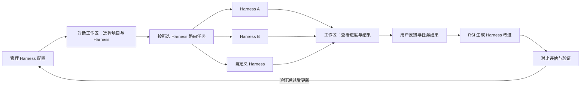

<p align="center">
  
</p>

<h1 align="center">OpenMetaHarness</h1>

<h3 align="center">Build, manage, and evolve your agent harnesses.</h3>

<p align="center">
  <strong>用户与 AI 共同构建、管理和持续改进 Harness。<br />把 Agent 的工作方式变成可编辑、可运行、可评估的配置。</strong>
</p>

<p align="center">
  <a href="README.md">中文</a> · <a href="README.en.md">English</a>
</p>

<p align="center">
  <a href="#建设路线"></a>
  <a href="#下载安装"></a>
  <a href="#本地开发"></a>
  <a href="LICENSE"></a>
</p>

<p align="center">
  <a href="#下载安装">下载安装</a> ·
  <a href="#核心体验">核心体验</a> ·
  <a href="#本地开发">开始开发</a> ·
  <a href="#建设路线">建设路线</a> ·
  <a href="https://github.com/ViaTumLab/OpenMetaHarness/releases">版本发布</a> ·
  <a href="#鸣谢">鸣谢</a>
</p>

<br />

---

## 下载安装

OpenMetaHarness 从 YAgent 基础演进，由 ViaTumLab 维护；新客户端名称为 **ViaHarness Studio**。当前代码和已发布安装包仍是 Yan Agent / YAgent 基线，安装后的应用名为 **Yan Agent**。新项目不重写执行内核，重点建设外部 Harness 的可视化配置、用户与模型共同维护、路由和版本管理，并规划 OpenCode / OpenHarness 适配与后续 RSI 改进。详见[产品与代码开发计划](docs/plans/openmetaharness-product-and-development-plan.md)。

**[下载 macOS Apple 芯片预览版](https://github.com/ViaTumLab/OpenMetaHarness/releases/tag/macos-v1.7.0-preview.2)** · [所有版本](https://github.com/ViaTumLab/OpenMetaHarness/releases) · [构建状态](https://github.com/ViaTumLab/OpenMetaHarness/actions/workflows/macos-build.yml)

| 平台 | 当前状态 | 获取方式 |
| --- | --- | --- |
| macOS · Apple 芯片（M 系列 / arm64） | 预览版，临时签名，未公证 | Release 中的 `.dmg` 和 `SHA256SUMS` |
| macOS · Intel（x64） | 暂不支持 | 内核补丁仍需单独适配 |
| Windows · x64 | 保留源码构建支持 | 在 Windows 上运行 `npm run build`；本次 Mac 预览版不含 Windows 安装包 |

### 在 Mac 上安装

1. 下载 Release 附件中的 `.dmg`，打开后将 **Yan Agent** 拖入 **Applications / 应用程序**。
2. 从「应用程序」启动。当前版本尚未经过 Apple 公证，macOS 可能阻止首次打开；确认来自本仓库且校验值一致后，可按 [Apple 官方说明](https://support.apple.com/102445) 在「系统设置 → 隐私与安全性」中选择「仍要打开」。无需关闭整个系统的 Gatekeeper。
3. 在设置中添加模型服务，配置 API 地址和 API Key，选择可用模型。模型服务的账号和用量费用由对应提供商提供，不包含在客户端中。
4. 选择项目工作区，创建对话并发送任务。无需为了安装 DMG 而安装本项目的 npm 开发依赖。

需要核对下载完整性时，将 `.dmg` 和 `SHA256SUMS` 下载到同一目录，在该目录运行：

```sh
shasum -a 256 -c SHA256SUMS
```

### macOS 预览版范围

- 已验证打包应用启动、内置 OpenCode / CodeGraph / OfficeCLI 运行组件，以及 18 种模型服务的本地接口适配测试。测试使用模拟服务，不代表真实账号已经配置或认证。
- Windows 专属桌面控制、应用快照和语音识别暂不支持 macOS。
- Chromium 会在安装 Playwright 插件时下载；首次使用需要网络。
- 更新需手动下载新的 Mac 安装包。Intel 版本、Developer ID 签名和 Apple 公证仍待完成。
- Harness 管理、对话路由和 RSI 持续改进属于下文的建设规划，不是当前预览版的已完成功能。

Apple 正式公证需要开发者会员，通常为 **99 美元/年**，当地价格以 [Apple 注册页面](https://developer.apple.com/programs/enroll/) 为准。公证服务包含在会员能力中，不按每个安装包另收费用。当前预览版的安装与源码构建不要求购买会员。具体准备、项目适配与提交命令见 [macOS 发布与公证指南](docs/macos-release.md)。

## 让不同的 Harness，在同一个工作区里各展所长

OpenMetaHarness 是由 ViaTumLab 维护、以 Harness 为核心的开源平台项目，计划通过 **ViaHarness Studio** 客户端提供可视化工作台。我们希望让用户通过可视化界面维护 Agent 的工作方式，让模型通过同一套配置与变更机制提出改进：创建自己的 Harness，选择任务路由，再查看过程、审阅结果和比较版本。

通过用户反馈与 RSI（Recursive Self-Improvement，递归自我改进）算法持续优化 Harness，**让 OpenMetaHarness 越用效果越好，是我们的建设目标。**

<table>
  <tr>
    <td width="33%" valign="top">
      <h3>01 · 统一管理</h3>
      <p>可视化配置指令、模型、工具、上下文与策略，管理 Harness 的版本、连接和可用状态。</p>
    </td>
    <td width="33%" valign="top">
      <h3>02 · 对话路由</h3>
      <p>在工作区选择本次对话的 Harness，让任务进入合适的执行环境。</p>
    </td>
    <td width="33%" valign="top">
      <h3>03 · 持续改进</h3>
      <p>把用户反馈与任务结果转化为改进依据，通过 RSI 迭代 Harness，让后续任务做得更好。</p>
    </td>
  </tr>
</table>

> [!NOTE]
> 当前已有 Yan Agent / YAgent 桌面智能体工作区。上方介绍的可视化 Harness 管理、人机共同维护、对话路由与反馈驱动的 RSI 改进为下一阶段的核心规划，具体范围与验收标准见[开发计划](docs/plans/openmetaharness-product-and-development-plan.md)。

## 为什么以 Harness 为核心

完成一个任务，需要模型，也需要围绕模型组织上下文、工具、执行流程与反馈的 Harness。不同任务适合不同的执行方式：编码、研究、自动化操作，可以有各自的配置与工作流程。

OpenMetaHarness 将 Harness 作为有独立身份、配置和版本的核心对象：**用户与 AI 在同一工作区中构建和维护 Harness，把任务交给指定的执行后端，并通过评估验证每次改进。** 模型选择决定使用哪个模型服务，Harness 决定任务如何组织和执行；规划中的适配器将连接 OpenCode、OpenHarness 等运行后端，由后端承载执行。

## 核心体验

### 1. 配置你自己的 Harness

规划中的可视化编辑器将支持维护指令、模型、工具、技能、上下文、权限与验收规则，并单独管理运行后端的连接和能力。用户可以手动编辑；模型可以解释配置、生成修改提案。两者使用同一套草稿、校验、差异比较、评估和发布机制，保留版本记录与回退能力。

### 2. 在对话工作区选择执行方式

发起对话时，在工作区选择项目和 Harness，再发送任务。同一个项目可以为不同对话选择不同 Harness，让编码、调研与其他工作使用各自合适的执行方式。

路由以用户的明确选择为起点：**发送前看得见当前选择，发送后知道任务交给了谁。**

### 3. 在同一处跟进任务与结果

目标是让不同 Harness 的执行进度、输出与产物回到同一个工作区，方便继续对话和审阅交付。文件变更、工具调用与审批等能力，将根据各 Harness 的接口和适配情况逐步接入。

### 4. 让每次反馈，成为下一次改进的起点

规划中的改进机制将结合用户评价、纠正意见与任务执行结果，通过 RSI 算法反复提出、验证和迭代 Harness 的改进方案。优化方向包括上下文组织、提示与规则、工具使用及任务执行流程，具体范围取决于各 Harness 开放的配置与适配能力。

**执行任务 → 收集反馈 → RSI 生成改进 → 评估验证 → 更新 Harness → 再次执行。**

每轮改进都需要与现有版本对比评估，验证有效后再应用，并保留版本记录与回退能力。我们的目标是让真实使用积累为可验证的改进，让 OpenMetaHarness 逐步更适合你的任务，越用效果越好。



*上图展示规划中的交互流程，具体可接入的 Harness 以实际发布的适配器为准。*

## 你可以怎样使用

| 场景 | 规划中的使用方式 |
| --- | --- |
| 开发一个新功能 | 在项目对话中选择用于编码的 Harness，提交需求并审阅代码变更 |
| 围绕同一个项目做调研 | 新建对话，选择用于研究的 Harness，整理资料与结论 |
| 使用自己的执行环境 | 在管理入口添加自定义 Harness，再从对话工作区选择它 |
| 为不同任务保留不同配置 | 管理多套 Harness 配置，发起任务时选择对应的执行方式 |
| 让重复任务做得更好 | 提供反馈与纠正意见，通过 RSI 生成并验证 Harness 改进，应用到后续任务 |

## 现有工作区能力

以下为 Yan Agent / YAgent 基线已有的桌面工作区，供 OpenMetaHarness 迁移客户端与基础模块时参考。新的 Harness 管理界面尚在规划中。

<p align="center">
  
</p>
<p align="center"><sub>Yan Agent / YAgent 基线截图 · ViaHarness Studio 可视化工作台规划中</sub></p>

- **项目与代码：** 阅读文件、检索符号、分析项目结构、修改代码与运行测试。
- **任务协作：** 组织多个智能体处理任务，查看执行进度与交付结果。
- **浏览器与工具：** 操作内置浏览器，连接桌面工具、插件、技能与 MCP 服务。
- **模型接入：** 配置不同模型服务，并为任务选择合适的模型。
- **变更审阅：** 查看文件差异，通过 Git 与工作区管理开发过程。

## 建设路线

完整的功能设计、代码架构、基础能力缺口、分阶段任务与验收标准见[《OpenMetaHarness：产品与代码开发计划》](docs/plans/openmetaharness-product-and-development-plan.md)。

- [ ] **Harness 管理：** 可视化配置、草稿校验、版本发布与回退，以及独立的后端连接管理。
- [ ] **人机共同维护：** 用户与模型编辑同一配置对象，提供修改提案、差异比较与评估结果。
- [ ] **工作区选择：** 在发起对话时选择 Harness，清楚展示当前路由。
- [ ] **执行接入：** 验证 OpenCode / OpenHarness 适配，不重写执行内核；接回状态、审批、中断与输出。
- [ ] **反馈闭环：** 收集用户评价、纠正意见与任务结果，形成 Harness 改进依据。
- [ ] **RSI 持续改进：** 生成候选改进、对比评估、迭代更新，并支持版本追踪与回退。
- [ ] **适配扩展：** 完善接入约定，逐步支持更多 Harness 与自定义实现。

## 本地开发

支持构建 **Windows x64** 与 **macOS Apple 芯片（arm64）** 版本。准备 Git、Node.js 22 和 npm：

```sh
git clone https://github.com/ViaTumLab/OpenMetaHarness.git
cd OpenMetaHarness
npm ci
npm run dev
```

| 命令 | 用途 |
| --- | --- |
| `npm start` | 启动应用 |
| `npm test` | 运行单元测试 |
| `npm run build` | 构建 Windows 安装包 |
| `npm run build:release` | 构建安装包与便携版 |
| `npm run build:mac` | 构建 Apple 芯片 DMG，并验证打包结果、模型适配与应用启动 |
| `npm run verify:mac` | 重新验证已构建的 macOS 应用 |

部分功能需要准备额外运行时，可参考 `package.json` 中的 `build:desktop-bridge`、`build:cua-driver` 与 `build:playwright` 命令。构建产物位于 `dist/`。

macOS 请使用 arm64 Node.js。构建时需要联网下载依赖和 Chromium 校验资源，详细步骤见 [macOS 发布指南](docs/macos-release.md)。GitHub Actions 会验证 Mac 构建；维护者推送 `macos-v*` 标签后，只有测试成功才会发布带校验值的预览版。

## 参与项目

欢迎通过 Pull Request 参与 Harness 接入、工作区路由、反馈机制、RSI 改进与评估、配置管理和体验优化。也欢迎分享你希望接入的 Harness 与实际使用场景。提交改动时请说明使用场景、变更范围与验证结果。

## 鸣谢

感谢 **[Yan-Agent](https://github.com/666-gy/Yan-Agent)**、**[Yanxi / 666-gy](https://github.com/666-gy)** 及所有贡献者的开源工作与贡献。感谢 OpenCode、Electron 及其他开源项目提供的基础能力。

## 许可证

本项目采用 [MIT License](LICENSE)。相关版权声明与许可文本予以保留。第三方组件、技能和素材遵循各自许可证，详见 [第三方声明](lib/THIRD_PARTY_NOTICES.md) 和 [技能声明](lib/skills/THIRD_PARTY_NOTICES.md)。
