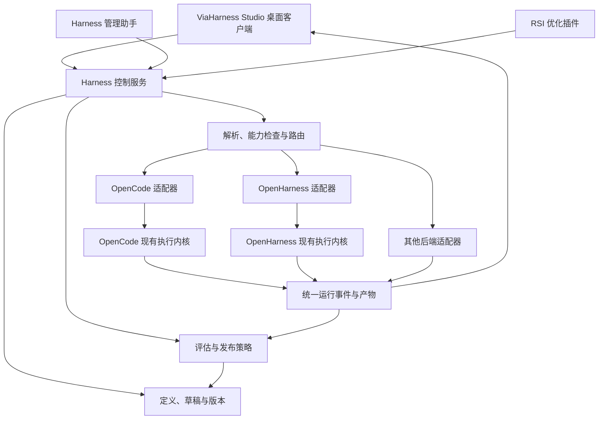

# OpenMetaHarness：产品与代码开发计划

**OpenMetaHarness — Build, manage, and evolve your agent harnesses.**

中文释义：构建、管理并持续改进你的 Agent Harness。

日期：2026-10-16 · 文档版本：1.1 · 状态：项目名称与产品方向已确认，技术方案与排期为实施建议。

本文统一记录项目定位、功能设计、客户端方案、代码架构、现有基础能力缺口、开发任务与验收标准，可作为新项目立项和拆分开发任务的基础。

## 1. 产品决策

**创建一个让用户与 AI 共同设计、维护、运行和改进 Harness 的开源工作台。**

核心对象是 Harness；对话、执行引擎和桌面客户端围绕它组织。用户可以手动调整 Harness，模型可以解释配置、提出修改、运行评估；后续 RSI 算法通过相同接口产生候选版本。

本计划遵循已确认的范围：**不重写执行内核。** OpenCode 与 OpenHarness 提供已有运行能力；新项目建设 Harness 定义、可视化管理、路由、版本治理与评估闭环。YAgent 是客户端能力与部分基础模块的迁移来源。

### 项目身份与命名

| 项目 | 约定 | 状态 |
| --- | --- | --- |
| 项目名称 | **OpenMetaHarness** | 已确认 |
| 英文标语 | **Build, manage, and evolve your agent harnesses.** | 已确认 |
| 中文定位 | 用户与 AI 共同构建、管理和持续改进 Harness 的开源平台 | 本计划的产品定义 |
| 客户端名称 | **ViaHarness Studio** | 已确认，作为 OpenMetaHarness 的可视化客户端 |
| GitHub 仓库 | `ViaTumLab/OpenMetaHarness` | 当前 YAgent 仓库按新品牌更名，保留历史 |

OpenMetaHarness 表达开放的 Harness 管理与演化层：将不同执行后端之上的工作方式统一为可维护、可路由、可评估的对象。ViaHarness Studio 是面向用户的可视化客户端。项目以人工维护和模型辅助起步，逐步接入 RSI；名称表达长期方向，不代表首版已经具备成熟的自主改进能力。

产品描述：**把 Agent 的工作方式变成可编辑、可运行、可评估、可演化的 Harness。**

### 三条产品主线

| 主线 | 产品能力 | 首版体现 |
| --- | --- | --- |
| Build：构建 | 定义 Harness，组合模型、说明、工具、技能、上下文与策略 | 模板创建、分区编辑、配置验证、试运行 |
| Manage：管理 | 维护多个 Harness 的版本、连接、路由和运行记录 | Harness 库、发布与回退、手动路由、配置来源与运行追溯 |
| Evolve：演化 | 将反馈转化为有证据的改进 | AI 修改提案、版本比较、基础评估；后续接入 RSI |

### 已确认的范围与架构建议

- **已确认：** 新项目名称为 OpenMetaHarness，客户端为 ViaHarness Studio；以 Harness 为核心；支持用户可视化维护和模型维护；后续接入 RSI；提供易用客户端；不重写执行内核。
- **架构建议：** OpenCode 与 OpenHarness 作为并列后端，通过统一适配器接入；当前仓库更名后承载新项目，使用清晰的包边界选择性迁移 YAgent 能力。
- **实施前验证：** 后端配置隔离、能力映射、恢复语义、双平台打包以及开发工作量。

### 目标用户与核心创新

首批用户是需要重复使用 Agent 工作方式的开发者、研究人员和技术团队。第一批验证场景以代码修复为主，再扩展到资料研究与文档交付。

本项目重点建设四项产品能力：

1. **Harness 成为一等对象：** 有独立身份、可读配置、不可变版本、运行记录与评估结果。
2. **用户与 AI 共同维护：** 图形界面和模型工具编辑同一份草稿，使用相同校验、差异和发布机制。
3. **跨后端配置与路由：** 用户选择工作方式，系统明确解析其执行后端、支持能力和实际生效配置。
4. **证据驱动的演化：** 每次改进对应候选版本、测试结果与发布决策，为 RSI 提供可替换的算法接口。

以上是项目的差异化建设目标，不构成对相关领域“首次实现”的查新结论。

### 如何理解 V1 → V2 → 新项目

用户提出的演进关系可以作为产品叙事：执行能力 → Harness 基础设施 → Harness 的可视化管理与持续改进。但两份上游代码并非天然的上下层关系：

- OpenCode 已经包含会话、工具、权限等 Harness 能力，并提供 HTTP 服务接口。[官方服务文档](https://opencode.ai/docs/server/)
- OpenHarness 也有自己的 Agent Loop，并组合工具、记忆、技能与 Hooks。[项目说明](https://github.com/HKUDS/OpenHarness)
- 因此，推荐将两者作为**并列的运行后端**。每次运行由一个后端拥有执行循环，新项目负责选择、配置与观察。

若未来确实需要“OpenCode 执行 + 独立的 OpenHarness 模块”，只能逐项验证可分离模块的接口，不能默认把两个完整 Runtime 串起来。

## 2. 参考项目的取舍

### OpenCode：保留成熟的执行路径

首个执行后端沿用 YAgent 当前固定的 OpenCode 1.18.11 集成，承接现有编码任务。通过适配器隔离其会话 ID、权限事件、输出流和配置格式。

当前仓库使用官方包和版本相关的运行时补丁，并非完整的 OpenCode 源码分支。第一阶段不升级、不改写该内核；将补丁与版本校验纳入适配器的兼容性测试。

### OpenHarness：第二个后端与 Harness 组件设计来源

沿用 2026-10-16 前次规划的源码检查，固定到提交 `9b2efd795c6aa09f88b0c257d269a9e518da6ae7`，`pyproject.toml` 标记版本 0.1.9。已核实：

- `ui/runtime.py` 的 `RuntimeBundle` 聚合执行引擎、工具注册表、MCP、Hooks、会话和记忆后端，并有额外技能、插件目录等扩展参数。[源码](https://github.com/HKUDS/OpenHarness/blob/9b2efd795c6aa09f88b0c257d269a9e518da6ae7/src/openharness/ui/runtime.py)
- `ui/protocol.py` 定义提交输入、审批回复、问题回复、中断等请求，以及文本增量、工具事件、状态快照等输出。[协议源码](https://github.com/HKUDS/OpenHarness/blob/9b2efd795c6aa09f88b0c257d269a9e518da6ae7/src/openharness/ui/protocol.py)
- `ui/backend_host.py` 有结构化 stdin/stdout 主机，输出使用 `OHJSON:` 前缀；CLI 提供 `--backend-only` 入口。这是首选接入验证方向。[后端源码](https://github.com/HKUDS/OpenHarness/blob/9b2efd795c6aa09f88b0c257d269a9e518da6ae7/src/openharness/ui/backend_host.py)

这些是源码检查结论，**尚未完成本地运行、双平台安装、取消、恢复和配置隔离的兼容性验证**。其终端 UI 协议也不应被当成已有稳定版本承诺的通用 Harness 标准。

新项目通过一个薄的 Python 适配进程使用其扩展点。若某项配置无法通过公开或已验证的扩展点实现，先标记不支持；不为凑齐界面选项而侵入执行循环。

### YAgent：迁移能力，而非搬运整个应用

优先迁移模型连接管理、项目/工作区、任务日志与恢复、Git 审阅、附件、技能/MCP 管理等经过验证的模块。外部桌面协同作为兼容能力保留，但不作为统一主执行路径的唯一实现。

现有 `renderer/renderer.js` 约 24,260 行，`lib/opencode-sidecar.js` 约 6,049 行。新项目建立独立前端与适配边界；旧代码通过小模块迁移，避免把上述文件整体复制成新的核心。

## 3. Harness 的领域模型

**Harness 是一套有版本的工作方式：目标与说明、模型选择、工具、上下文策略、记忆策略、权限、执行流程和验收规则。**

一个运行后端可以承载多个 Harness。例如“谨慎修复”“快速原型”“资料研究”都可以使用 OpenCode；相同研究方案也可复制为 OpenHarness 版本，再比较差异。

| 对象 | 职责 | 关键约束 |
| --- | --- | --- |
| RuntimeConnection | 本地程序或服务连接、认证、版本与能力 | 与 Harness 分离；多个 Harness 可引用一个连接 |
| Harness | 稳定身份、名称、用途、标签、当前发布版本 | ID 不随改名变化；支持归档 |
| HarnessVersion | 不可变配置、依赖锁定、适用后端、创建来源 | 发布后不直接改写；修改产生新版本 |
| HarnessDraft | 用户或模型正在编辑的配置 | 带基础版本和修订号；并发冲突显式处理 |
| RoutePolicy | 项目默认值、规则、候选集与兜底策略 | 规则有版本，路由结果可解释 |
| Run / Attempt | 任务运行及一次具体派发 | 记录 Harness 版本、配置快照、实际后端和工作区 |
| ChangeProposal | 修改内容、原因、证据、影响与评估结果 | 人和模型使用同一变更机制 |
| EvaluationSuite / EvaluationRun | 测试集、评估配置、结果及比较 | 与生产任务分开，不把正常结束当作质量达标 |
| MemoryNamespace | 动态记忆内容及归属 | 与 Harness 配置版本分开；运行记录引用记忆快照或摘要 |

建议首版配置契约采用 JSON Schema；可读写 YAML/JSON。编辑器和模型工具共用同一套验证器。以下是目标格式示意，尚未实现：

```yaml
schemaVersion: 1
id: careful-coder
name: 谨慎修复
runtime:
  connectionId: local-opencode
  adapter: opencode
  compatibility: pinned
model:
  connectionRef: coding-model
instructions:
  entrypoint: instructions/system.md
skills:
  - id: code-review
    revision: content-sha256
tools:
  profileRef: code-tools
context:
  strategy: project-and-recent-history
memory:
  scope: project-and-harness
permissions:
  policyRef: workspace-edit
workflow:
  template: inspect-plan-edit-test
evaluation:
  suiteRef: code-repair-regression
limits:
  maxDurationSeconds: 1800
extensions: {}
```

配置中存凭据引用，不存密钥。流程模板区分“提示约定”和“程序强制步骤”，界面明确标记；不能把提示词中的“先测试再交付”显示成已经强制执行的流程。

### 配置解析与能力约束

默认值 → Harness 发布版本 → 允许的项目覆盖 → 允许的本轮覆盖；最终解析得到不可变的 `ResolvedHarness`。权限另外求交集：用户授权 ∩ 项目策略 ∩ 后端实际可执行限制，不能因层级覆盖而扩大权限。

`ResolvedHarness` 记录字段来源、依赖内容哈希、后端版本、支持/降级/拒绝项，以及不含密钥的配置摘要。运行启动后保持不变；编辑只影响后续运行。

通用字段仅覆盖可验证语义。后端专属字段放入 `extensions.opencode` / `extensions.openharness`。不能可靠映射的能力明确拒绝，不静默丢弃；可选项的降级必须在运行前可见。

## 4. 客户端设计

主导航建议：**工作台 / Harness / 运行记录 / 评估与改进 / 连接与资源**。首版聚焦 Harness 的创建与使用，复杂编排图放到后续。

| 页面 | 用户能完成什么 | MVP 交付范围 |
| --- | --- | --- |
| 工作台 | 选项目与 Harness，提交任务，跟进过程与结果 | Harness 选择器、版本标记、运行状态、停止、审批、产物 |
| Harness 库 | 创建、复制、查找和维护工作方式 | 卡片/列表、用途、后端、版本、就绪状态、最近使用 |
| Harness 编辑器 | 修改指令、工具、技能、记忆、权限和模型 | 分区表单、字段解释、配置预览、校验、保存草稿、发布 |
| Harness 详情 | 理解这套工作方式与实际表现 | 概览、版本差异、运行记录、改进提案 |
| 连接与资源 | 管理后端、模型连接、技能、MCP 与凭据引用 | 安装检测、认证状态、协议握手、能力列表、诊断建议 |
| 运行详情 | 知道谁在执行、用了什么配置、为何这样路由 | 时间线、工具调用、等待原因、错误、文件变化、来源 |
| 评估与改进 | 对比候选版本，接受或拒绝模型建议 | 技术预览先建立入口与数据模型；MVP 提供基础版本对比、提案处理与人工发布 |

编辑器建议采用三栏：左侧配置分区，中间表单，右侧“效果解释 / 当前生效值 / AI 助手”。专家可切换 YAML，但表单与源码必须通过同一契约互相转换。

用户说“复制这个 Harness，研究时只用网页和只读文件工具”，AI 应生成可查看的配置差异；用户也可以直接点选工具。两种操作进入同一个草稿。

首版提供三套模板：代码修复、只读研究、文档交付。模板应根据已连接后端的能力筛选；缺失网页工具、Office 工具或只读执行限制时显示缺项，不声称模板已经可用。

### 最小演示闭环

1. 添加 OpenCode 连接，从“代码修复”模板创建 Harness。
2. 在编辑器添加规则、选定技能和权限策略；校验后发布 v1。
3. 在工作台选择 v1 执行任务，查看版本、工具过程与结果。
4. 用户反馈“测试不够完整”，AI 创建改进提案和 v2 草稿。
5. 用固定测试集比较 v1/v2，用户查看证据后发布 v2。
6. 对后续任务选择 v2；随时将默认版本回退到 v1。
7. 复制为 OpenHarness 后端版本，显示兼容差异，再运行相同任务进行比较。

这条闭环比“接了多少模型、做了多少聊天功能”更能表达产品价值。

## 5. 路由设计

### 阶段一：用户可控的手动路由

首版以会话为默认绑定单位，以每轮运行快照为最终执行依据。选择顺序：本轮明确选择 → 会话绑定 → 项目默认 → 全局默认。

明确选择失效时提示修复或重新选择，不悄悄换后端。已有会话固定其 Harness 版本；发布新版后提供“升级本会话”操作。运行中不切换后端或修改配置。

同一后端续聊使用其原生会话 ID。跨后端切换默认创建关联新会话，携带目标、约束、摘要、必要文件引用和已验证结果；不转移既有审批、运行中的工具或后端私有状态。附件按能力检查，不可用内容不得无声丢失。

### 阶段二：确定性规则路由

仅在用户选择“自动”时启用。规则条件包括项目、任务类型标签、附件类型、必需工具、只读要求及预算。先做能力与授权过滤，再按显式优先级匹配；同优先级按稳定规则 ID 排序。无候选时给出具体缺项。

提供路由模拟器：输入一段任务，显示候选、排除原因、命中规则及最终结果；不实际派发任务。

### 阶段三：模型建议与学习路由

模型可以推荐 Harness；早期由用户确认，后续在授权范围内自动选择。记录建议依据、备选与用户纠正。模型只能在已验证候选集中选择，不能借路由修改权限或导入未知工具。

优先实现任务级和回合间路由。任务内阶段切换放到后续，要求明确阶段产物和交接协议；不在活跃工具调用中切换执行器。

### 故障语义

- 未派发的连接失败可有界重试；手动选定的目标仍需保持。
- 派发已确认后通过原运行 ID 查询/重连，不能通过重新发送提示来模拟恢复。
- 派发是否成功不明时进入 `uncertain`，保持工作区占用，等待核验。
- “停止请求已发送”与“已停止”分开；未确认停止前不启动冲突写入。
- 有副作用的失败任务不自动换 Harness 重跑。用户明确重试时创建新 Attempt，并展示已有副作用。

## 6. 用户管理、模型管理与 RSI

三个主体使用同一领域服务：UI、Harness 管理助手、RSI 插件。控制服务校验身份与授权，模型不得直接写配置数据库或凭据文件。

建议模型工具：`list_harnesses`、`inspect_harness`、`create_draft`、`propose_patch`、`validate_draft`、`run_evaluation`、`compare_versions`。发布与回滚另外检查授权，不能由模型自行声明有权限。

| 自动化级别 | 行为 |
| --- | --- |
| 手动 | 用户编辑；模型只解释和分析 |
| 建议（默认） | 模型创建草稿、差异与评估建议，用户发布 |
| 受控自动改进（后续） | 用户预先指定可修改字段、测试集、成本上限和发布门槛，系统在范围内执行 |

权限、凭据、数据发送目标、可执行 Hooks 等字段单独管理；修改它们不属于普通提示优化。用户可锁定字段、暂停自动改进并查看每次修改的主体与依据。

RSI 接口先做成可插拔优化器，不提前绑定一种算法：

`运行证据 + 用户反馈 → 候选补丁 → 静态验证 → 隔离评估 → 对比报告 → 发布策略 → 新版本`

评估必须保存基线版本、模型与依赖版本、测试输入、评分器、成本、重复次数及失败案例。持有独立保留测试集；避免候选生成器同时控制全部评分标准。运行正常结束、TODO 全勾选和模型自评均不能单独证明质量提升。

第一批指标：任务验收通过率、人工纠正次数、工具失败率、耗时、已报告或可解释估算的成本。未知用量显示未知。按任务类型分组；随机性较大的任务做重复评估，样本不足时显示“证据不足”。

评估副作用在临时工作区/worktree 和模拟外部服务中隔离；worktree 不等于操作系统沙箱，真实外部服务测试需要独立授权与预算。

## 7. 技术架构与代码边界



### 推荐工程组织

当前 `ViaTumLab/YAgent` 仓库更名为 `ViaTumLab/OpenMetaHarness` 并保留历史；新架构建议采用单仓多包，在迁移期间逐步建立独立模块。沿用现有项目的 JS 技术基础，新增控制层和客户端使用 TypeScript；OpenHarness 保持 Python，通过进程边界接入。以下为拟建目录，不是已有代码：

```text
apps/
  desktop/                   Electron 外壳、窗口与操作系统集成
  studio/                    React 客户端、Harness 编辑器与工作台
packages/
  harness-schema/            契约、版本、字段来源、兼容性定义
  harness-core/              注册、草稿、差异、发布、回滚
  harness-router/            手动选择、规则、模拟器
  runtime-contract/          后端能力、统一事件、取消与恢复语义
  adapter-opencode/          迁移现有 sidecar 集成，保留执行内核
  adapter-openharness/       TS 侧进程管理与事件转换
  run-service/               派发、幂等、工作区租约、运行状态
  harness-evals/             测试集、评分与基线比较
  harness-agent-tools/       模型管理接口，复用领域服务
  persistence/               数据迁移、事务、日志与附件索引
  ui/                        共享组件
workers/
  openharness-bridge/        薄 Python 包，使用固定版本后端接口
examples/harnesses/          模板及脱敏配置示例
tests/contracts/             各后端必须通过的契约测试
tests/e2e/                   桌面端完整流程
```

首版控制服务由 Electron 启动为独立进程，避免日志和解析阻塞界面。桌面端通过窄 IPC 接口访问；不需要先建设云服务。后续 Web 客户端才增加带认证的服务接口。

应用退出后第一版不承诺继续后台运行；保存状态并核验后端是否仍活跃。恢复记录与恢复执行分别展示，不能把回放日志称为任务续跑。

存储建议使用 SQLite 管理元数据、版本快照、提案、运行状态与事件序号，附件和大日志采用内容寻址文件。数据库是已发布定义的唯一事实来源；YAML 是编辑/导入/导出格式，避免同时维护两套可写配置。数据库驱动及两平台打包兼容在阶段 0 验证。

### RuntimeAdapter 的最小契约

```typescript
interface RuntimeAdapter {
  describe(): AdapterManifest;
  probe(connection: ConnectionRef): Promise<HealthReport>;
  resolve(spec: HarnessVersion, context: RunContext): Promise<ResolvedHarness>;
  start(request: StartRequest): Promise<RunHandle>;
  events(handle: RunHandle, cursor?: string): AsyncIterable<RunEvent>;
  inspect(handle: RunHandle): Promise<RunStatus>;
  cancel(handle: RunHandle): Promise<CancelReceipt>;
  replyInteraction(handle: RunHandle, reply: InteractionReply): Promise<void>;
}
```

恢复、会话分叉、工具追踪、文件 diff、用量、权限强制、图片输入、MCP、Hooks 分别作为能力声明。不能用单个 `supportsResume` 概括日志回放、断线重连与跨进程恢复。

统一事件至少携带 `runId / attemptId / harnessVersionId / backendSessionId / eventId / sequence / timestamp`。适配器做原始协议映射；业务与 UI 不直接解析厂商事件。保存来源和有界脱敏原始片段便于诊断。

同一事件去重、同一运行只结算一次；服务事务与派发日志配合恢复核验。不能仅依赖请求幂等键就宣称外部副作用“严格只执行一次”。

## 8. 当前版本可复用的基础与缺口

检查基线：YAgent `ad8a4f6`，package 版本 1.7.0。以下沿用 2026-10-16 前次规划的代码检查结论；本次命名与文档整理未重新运行应用测试。这些是局部检查，不是全仓库安全审计。

| 能力 | 当前证据与判断 | 新项目处理 | 优先级 |
| --- | --- | --- | --- |
| 执行适配 | `lib/yan-core/adapter.js` 已有 ProviderAdapter 和注册表，但主路径仍直接获取 OpenCode Adapter | 复用接口思路，扩展能力协商并统一主执行入口 | P0 |
| 任务状态与恢复 | `lib/yan-core/` 已有状态机、事件日志；`lib/main/recovery.js` 能恢复记录 | 迁移测试和设计，去掉 OpenCode 专用事件依赖 | P0 |
| 外部协作 | `lib/external-agents/` 已有任务存储、幂等、工作区串行和不确定状态 | 可复用语义；当前服务是子任务委派，不能直接充当通用主对话服务 | P0 |
| 多平台外部接入 | `adapters.js` 的 Codex/Claude 桌面探测路径限制 Windows；Reasonix 单独处理 | 首先验证 OpenHarness 结构化后端的 macOS/Windows 路径 | P0 |
| Harness 定义与生命周期 | 已有 ContinualHarness 记忆/策略条目、修订与回滚，但不是完整的多后端 Harness 注册中心 | 新建 Harness/Version/Draft/Proposal，不混用现有条目 ID | P0 |
| 权限的一致性 | `ipc-config.js` 会将四个 allow 开关强制设为 true；实际另有 sandbox/access 模式 | 统一权限模型与可执行语义，避免 UI 限制与实际执行不一致；不能据此认定所有现有权限失效 | P0 |
| 凭据处理 | `config.js` 有 safeStorage 和脱敏投影，但加密不可用时可回退明文 | 新存储默认禁用静默明文持久化；允许仅会话使用，凭据引用和导出脱敏 | P0 |
| 连接健康 | `OpenCodeProviderAdapter.healthCheck` 在 status 成功返回后直接 ok:true | 拆分安装、启动、协议、认证、能力、可执行状态，不用单一绿灯替代 | P0 |
| 会话格式升级 | `session-store.js` 已有 schemaVersion 与迁移 | 保留迁移方法，增加后端绑定和不可变版本引用 | P0 |
| 用量语义 | Adapter 的 normalizeUsage 将缺失数据转换成 0 | 保留 unknown/reported/estimated，防止路由和评估误判成本 | P1 |
| 审批留痕 | `permission-audit.js` 明确是内存有界日志 | 增加持久化、脱敏、来源与保留期限，关联 run/attempt | P1 |
| 改进验证 | 已有条目使用归因；`harnessRunOutcome` 用正常结束与 TODO 判断成功 | 保留为运行信号，增加真实验收测试，不能直接作为 RSI 的质量奖励 | P1 |
| 可视化解释 | 当前记忆设置主要是开关、说明与删除；缺少完整 Harness 编辑/差异/版本页 | 新建 Harness 工作台 | P0 |
| 客户端维护 | 大型 renderer 与 sidecar 存在明显集中耦合 | 新 UI 按领域拆分；逐个移植成熟模块 | P0 |

另需从首版补齐：配置导入校验、凭据脱敏导出、依赖锁定、版本迁移备份、损坏恢复、数据删除策略、后端日志大小限制、统一错误码和首次运行诊断。

单机首版不引入多租户、组织 RBAC、云同步或计费系统。若以后加入远程多用户运行，再独立设计身份、隔离和协作权限。

### 前次规划的局部测试结果

执行了 7 个相关测试文件，覆盖 ContinualHarness、使用归因、会话格式、Core 恢复、交接、权限审计和外部协作。环境为 macOS / Node 24.1.0，而仓库文档推荐 Node 22。

汇总报告为 71 项：67 通过、1 跳过、3 失败。其中 2 项为真实断言不匹配：会话摘要多出 `deletionPending`，会话 MCP 的工具列表多出已存在的新工具；另 1 项是 `harness-usage.test.cjs` 长时间未退出后被主动终止，不能据此判断功能失败。需要在推荐 Node 版本上复核并区分测试陈旧与行为回归。

未运行整个测试集、未启动 GUI、未执行 OpenHarness 后端。不能将该检查描述为“当前版本测试全部通过”。详细结果见[原始局部测试报告](yagent-planning-baseline.txt)。

## 9. 分阶段开发计划

以下为小团队规划估算，假设 2 名熟悉 Electron/TypeScript 的全职工程师，其中 1 名能处理 Python 适配，并有兼职产品/设计支持。日历排期包含交叠开发；不是交付承诺。若单人推进，应按工作量与验证成本重新排期。

| 阶段 | 建议窗口 | 交付内容 | 退出条件 |
| --- | --- | --- | --- |
| 0：契约与接入验证 | 第 1 周 | 定义 Harness 对象、后端能力矩阵；OpenCode/OpenHarness 接入探针；新架构模块边界 | 两后端完成一次有工具调用的运行；OpenHarness 审批/中断/隔离被实测；确定打包方案 |
| 1：首条可运行链路 | 第 2–3 周 | 新项目骨架、契约、注册中心、版本快照、OpenCode Adapter、最小工作台；工作区互斥、幂等派发与未知状态处理 | 从客户端选择一套 Harness 运行、停止并查看记录；重启不丢状态，不重复派发冲突任务 |
| 2：管理与第二后端 | 第 4–6 周 | Harness 编辑器、连接管理、OpenHarness Adapter、配置兼容报告、手动路由 | 用户从界面创建并运行两种后端的 Harness，能辨认能力差异和实际路由 |
| 3：人机共同维护 | 第 7–8 周 | AI 配置助手、提案、差异、发布/回滚、基础评估 | 用户与模型修改同一草稿不覆盖彼此；候选版本可比较并人工发布 |
| 4：规则路由与发布稳定性 | 第 9–10 周 | 规则模拟器、工作区租约与恢复机制的故障加固、打包与迁移 | 自动模式路由可解释；失联不重复派发；目标平台通过契约与桌面流程测试 |
| 5：RSI 实验阶段 | MVP 后单独排期 | 优化器插件、保留测试集、受控发布、效果报告 | 有重复评估证据支持改进；可停止、可回退且成本受控 |

**第 6 周目标是技术预览，第 8–10 周目标是具有人机维护闭环的 MVP。** 首版不承诺成熟 RSI；从一开始留下完整版本与评估数据。

### 可直接拆成 Issue/PR 的任务

| ID | 任务 | 主要目录/模块 | 依赖 | 验收要点 |
| --- | --- | --- | --- | --- |
| T01 | 架构 ADR 与上游版本锁定 | docs、runtime-contract | 无 | 明确两个并列后端、唯一执行循环、能力边界 |
| T02 | OpenHarness 接入探针 | workers/openharness-bridge | T01 | 运行、增量、工具、审批、中断；错误日志不污染事件协议 |
| T03 | Harness Schema 与解析器 | harness-schema | T01 | 合法性验证、字段来源、兼容报告、密钥引用 |
| T04 | 草稿/版本/发布服务 | harness-core、persistence | T03 | 不可变发布版本、CAS 冲突、差异与回退 |
| T05 | 通用运行服务与事件契约 | run-service、runtime-contract | T01,T03 | 先持久化意图、再派发；工作区互斥、去重、取消、不确定状态 |
| T06 | OpenCode Adapter 迁移 | adapter-opencode | T05 | 复用执行路径；UI 不接触 OpenCode 原始事件 |
| T07 | 最小客户端与连接向导 | desktop、studio | T03,T04,T05,T06 | 添加连接、创建 Harness、选择运行、展示结果 |
| T08 | OpenHarness 正式适配 | adapter-openharness、Python worker | T02,T05 | 配置隔离、会话绑定、能力矩阵、两平台冒烟 |
| T09 | Harness 编辑器与详情页 | studio、ui | T04,T07 | 表单/源码一致、差异预览、发布/归档、未知字段处理 |
| T10 | 手动路由与项目绑定 | harness-router、studio | T04,T06,T08 | 明确优先级、版本固定、目标失效不静默切换 |
| T11 | AI 维护工具与提案页 | harness-agent-tools、studio | T04,T09 | 与 UI 共用服务；字段锁、冲突、授权在模型之外执行 |
| T12 | 评估与版本比较 | harness-evals | T05,T11 | 隔离测试、固定基线、成本未知值、失败案例可追溯 |
| T13 | 规则路由模拟器 | harness-router、studio | T10 | 无调用模拟、能力过滤、确定性优先级、解释 |
| T14 | 恢复、迁移与发布门禁 | persistence、contracts、e2e | T08–T12 | 断线/重启不误重跑；凭据不出现在导出与日志中 |

### 首版验收场景

1. 用户创建、复制、编辑、发布、归档 Harness；历史运行仍能查看归档版本。
2. 同一后端的两套配置同时运行，不串工具、凭据、记忆或权限。
3. OpenCode 与 OpenHarness 各完成一项包含工具调用的任务，并正确展示审批/失败/终态。
4. 不支持的只读、图片、Hooks 或恢复能力在运行前可见；必需能力不满足时阻止运行。
5. 编辑运行所用 Harness 不改变当前运行；下一次使用新版需要明确解析并记录。
6. 用户与模型同时修改草稿，能发现冲突，不发生最后写入静默覆盖。
7. 崩溃后可恢复运行记录；未知外部状态先核验，不重新执行副作用。
8. 版本回滚只调整后续默认版本，不声称能撤销已经发生的文件或远端操作。
9. AI 提案的修改原因、作者、证据和评估结果均可查看。
10. 配置包可脱敏导出与重新导入，导入不会自动执行 Hooks 或安装未知程序。

## 10. 第一轮开发的具体起点

先完成一个窄而完整的纵向切片：**Harness 配置文件 → 验证与解析 → 选择后端 → 执行一次工具任务 → 保存带版本的结果 → 客户端可见。**

第一周不先画复杂工作流编辑器，也不先扩展大量外部 Agent。最先验证 OpenHarness 的配置隔离与控制协议，因为它决定“可视化修改的配置是否真的控制执行”。同时复核 YAgent 的局部失败测试，把可迁移能力建立在可重复的测试基线上。

首版明确延期：自由 DAG 编排、运行中无缝跨后端迁移、公共插件市场、云端多租户、无人监督自动改权限、完整自研 Agent Loop。新增产品价值集中在 Harness 的表达、治理、可观察性与验证闭环。

## 11. 仍需在实施前固化的决策

- 项目名称 OpenMetaHarness、客户端名称 ViaHarness Studio 与英文标语已确认；仓库品牌与计划先统一，客户端标题、包标识、配置命名空间与构建产物在应用迁移阶段同步。具体发布标识在创建工程时确定。
- 首发平台建议 macOS Apple 芯片与 Windows x64；预算不足时先完成 macOS，再扩展 Windows。
- OpenHarness 固定提交的结构化后端是否满足隔离与恢复要求；结果不足则缩小能力范围，并保留 OpenCode 默认路径。
- 首个评估集建议代码修复类任务，后续再加入研究与办公；避免一开始将多种任务混在一个总分里。
- 更名后的仓库模块边界与 YAgent 的迁移清单；保留上游来源、许可证与修改记录，不把第三方能力表述为全部自研。

尚未定案的技术决策应在对应模块开工前形成短 ADR。本文已统一采用 OpenMetaHarness；当前仓库先完成品牌更名，应用标识迁移和功能开发按上述阶段推进。本次更新覆盖品牌与计划，现有应用和执行内核保持当前基线。
